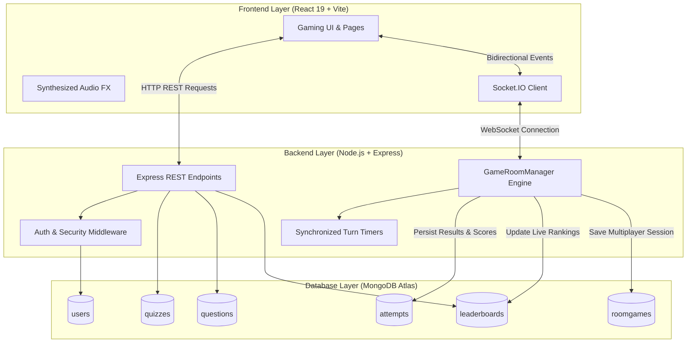
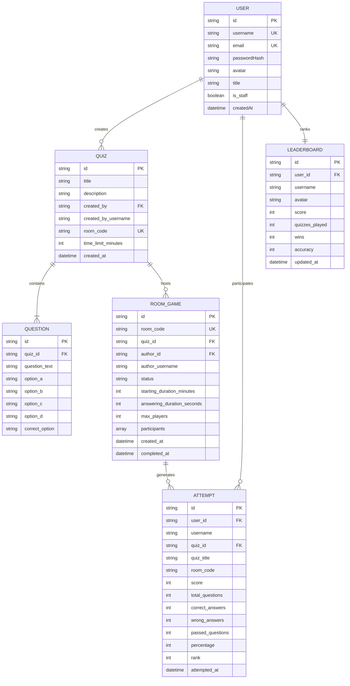
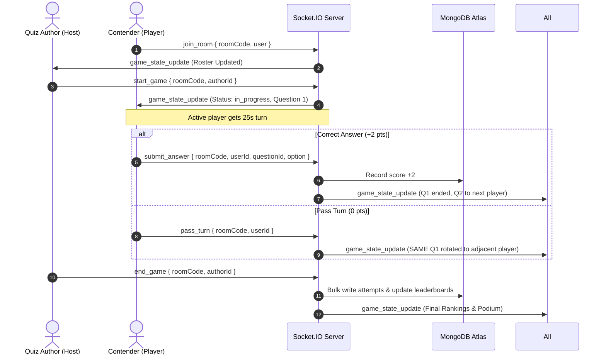

# QUIZ BATTLE: Real-time Circular Turn-Based Multiplayer Quiz Platform

---

## PROJECT REPORT & TECHNICAL DOCUMENTATION

**Project Name:** QUIZ BATTLE – Interactive Multiplayer & Circular Arena Quiz Platform  
**Academic Year:** 2026 – 2027  
**Project Members:**
1. **B. Karthik Reddy**
2. **E. Murali**
3. **R. Harsha**

**GitHub Repository:** [https://github.com/vu241fa04c65-murali/quizzbattle](https://github.com/vu241fa04c65-murali/quizzbattle)  
**Database:** MongoDB Atlas Cloud Database (NoSQL)  
**Backend:** Node.js & Express.js (JavaScript / TypeScript)  
**Real-Time Engine:** Socket.IO / WebSockets  
**Frontend:** React.js, Tailwind CSS, Vite, Lucide Icons  

---

## 1. Executive Summary & Abstract

Traditional online quiz applications operate primarily in a solitary, asynchronous format where users individually answer questions and compare static scores on a delayed leaderboard. **Quiz Battle** transforms online assessment into an immersive, synchronous, real-time multiplayer gaming experience inspired by broadcast quiz bowls and circular esports arenas.

The platform introduces a **Circular Turn-Based Multiplayer Engine** rendered on a circular gaming table where participants occupy designated visual seats around a central question dais. Operating over low-latency WebSockets (Socket.IO) backed by a persistent MongoDB Atlas cloud database, the system implements turn-based question rotation with sophisticated rules:
- **Rule A (Correct Answer):** Awards +2 marks, concludes the current question, and advances to the next question for the next participant in circular order.
- **Rule B (Incorrect Answer):** Deducts -1 mark, ends the current question, and assigns a new question to the next participant.
- **Rule C (The Pass Rule):** Awards 0 marks (no penalty), **retains the exact same question**, and passes the turn to the adjacent competitor. The question circulates until answered correctly or exhausted by all participants.
- **Rule D (Universal Pass):** If every player passes, the question is retired, and a fresh question is issued to the original starting player.
- **Author Isolation:** The quiz creator acts strictly as the **Game Controller / Host**, possessing administrative controls (Start, Pause, Resume, End Game) without participating as a competitor or polluting the player leaderboard.

---

## 2. Project Objectives

1. **Synchronous Real-Time Multiplayer Gameplay:** Transition beyond static single-player forms into an interactive live arena utilizing bidirectional WebSocket events.
2. **Circular Turn-Based Rotation:** Architect an automated turn engine featuring individual 25-second countdown timers, active turn indicators, and circular player rotation.
3. **Question Retention & Passing Mechanics:** Implement strategic passing rules where questions circulate among contenders without penalty, increasing competitiveness.
4. **Author & Player Role Separation:** Enforce architectural separation where the quiz host moderates the session (monitoring live scores and turn progress) without receiving answering rights or leaderboard scores.
5. **Real-Time Cloud Persistence:** Eliminate static/mock datasets by integrating MongoDB Atlas for dynamic CRUD operations on users, quizzes, attempts, and real-time leaderboards.
6. **Responsive Gaming UI/UX:** Deliver a neon purple and deep navy cyber-gaming interface featuring smooth animations, avatar highlights, sound effects, celebratory confetti, and mobile responsiveness.

---

## 3. Technology Stack

> [!IMPORTANT]
> The platform is built entirely on the modern JavaScript/TypeScript full-stack ecosystem. Python, Django, and local SQLite have been eliminated in favor of high-performance Node.js, Express, Socket.IO, and cloud MongoDB Atlas.

| Layer | Technology | Version | Purpose & Architectural Justification |
| :--- | :--- | :--- | :--- |
| **Frontend Framework** | **React.js** | 19.0.1 | Component-driven, declarative user interface managing complex multiplayer game states. |
| **Build & Tooling** | **Vite** | 8.3.5 | Ultra-fast Hot Module Replacement (HMR) and optimized ES module production bundling. |
| **Styling & Theming** | **Tailwind CSS** | 4.3.3 | Utility-first styling providing custom gradients, glowing neon borders, and dark navy cyber themes. |
| **Icons & Media** | **Lucide React** | 0.546.0 | Modern SVG icon system for intuitive gaming controls, badges, and dashboard metrics. |
| **Visual Effects** | **Canvas Confetti** | 1.9.4 | Canvas-based particle explosion animation triggered during victory and high scores. |
| **Backend Runtime** | **Node.js** | 24.x | Event-driven, non-blocking I/O runtime capable of sustaining concurrent WebSocket connections. |
| **Web Server** | **Express.js** | 4.21.2 | High-speed RESTful routing for user authentication, profile data, and quiz management. |
| **Real-Time Engine** | **Socket.IO** | 4.8.4 | Low-latency bidirectional WebSocket communication for room lobbies, turns, and live scores. |
| **Database** | **MongoDB Atlas** | Cloud v8+ | Globally distributed cloud NoSQL database providing document elasticity and fast indexing. |
| **Object Data Modeling** | **Mongoose** | 9.11.4 | Schema-enforced data validation, relationships, pre-save hooks, and atomic update operators. |
| **Security & Auth** | **Crypto / JWT** | SHA-256 | Salted cryptographic password hashing and token-based stateless session management. |
| **Deployment Target** | **Render.com / Cloud** | Production | Persistent Node.js Web Service capable of sustaining 24/7 WebSocket listeners. |

---

## 4. System Architecture & Data Flow

---

## 5. Database Design & Mongoose Schemas

The database layer runs on MongoDB Atlas and enforces structured Mongoose models ensuring data integrity, unique constraints, and anti-cheat validation.

---

## 6. Core Features & Circular Turn-Based Game Engine

### 6.1 Waiting Lobby & Duration Selection
- Upon quiz creation, the creator specifies a **Lobby Start Countdown** (5 minutes, 10 minutes, or 15 minutes) and a **Player Turn Limit** (Default: 25 seconds).
- A 5-character alphanumeric Room Code (e.g., `QZ782`) is generated.
- A scrollable participant panel displays real-time joins.
- The **Author** is visually branded with an amber Author Badge and isolated from the participant roster.
- When the lobby timer expires, the author is prompted to begin, or the author may initiate early via **Start Game Now**.

### 6.2 Circular Multiplayer Gaming Table
- **Circular Table Canvas:** A circular neon-purple gaming table arranged with dynamic polar coordinates:
  $$\theta_i = \left(\frac{2\pi}{N}\right) \cdot i - \frac{\pi}{2}$$
- **Active Contender Spotlight:** The current player's avatar pulses with golden rings, glowing border indicators, and a live synchronized countdown bar.
- **Center Question Dais:** The active question and 4 multiple-choice options are mounted in the table center. Non-active players observe options in disabled mode with an *"Active Turn: [PlayerName]"* overlay.

### 6.3 Exact Game Rules Matrix

| Rule | Action | Score Impact | Question Disposition | Turn Transition |
| :--- | :--- | :--- | :--- | :--- |
| **Rule A: Correct Answer** | Contender selects correct option | **+2 Marks** | Question Concludes | Moves to $(i+1) \pmod N$ with a **new** question. |
| **Rule B: Incorrect Answer** | Contender selects wrong option | **-1 Mark** | Question Concludes | Moves to $(i+1) \pmod N$ with a **new** question. |
| **Rule C: Pass Action** | Contender clicks **Pass** | **0 Marks** (No Penalty) | **Retains Same Question** | Moves to $(i+1) \pmod N$ with the **same** question. |
| **Rule D: Universal Pass** | All participants pass on question | **0 Marks** | Question Retired | Moves to original starter with a **new** question. |
| **Rule E: Timeout** | 25s timer reaches 0:00 | **0 Marks** | Treated as Rule C Pass | Advances turn to next player with same question. |
| **Rule F: Author Controls** | Host clicks Pause / Resume / End | N/A | State freezes / persists | Author controls game lifecycle without playing. |

---

## 7. Real-Time Socket.IO & REST API Specifications

### 7.1 WebSocket Events (`/socket.io`)

### 7.2 REST API Endpoints

| Method | Endpoint | Access | Purpose |
| :--- | :--- | :--- | :--- |
| `POST` | `/api/auth/register` | Public | Register new account with salted password hashing and create initial leaderboard record. |
| `POST` | `/api/auth/login` | Public | Verify credentials and return JWT session token. |
| `GET` | `/api/auth/me` | Authenticated | Retrieve authenticated user profile and session validity. |
| `GET` | `/api/quizzes` | Public | List all active quizzes with live question counts from MongoDB. |
| `POST` | `/api/quizzes` | Authenticated | Create custom quiz with multiple questions, duration limits, and unique room code. |
| `GET` | `/api/quizzes/code/:roomCode` | Public | Retrieve quiz metadata and room parameters by 5-character code. |
| `POST` | `/api/quizzes/submit` | Authenticated | Submit single-player quiz answers; server calculates score and updates leaderboard. |
| `GET` | `/api/leaderboard` | Public | Return dynamic rankings of all registered users sorted by score and accuracy. |
| `GET` | `/api/profile` | Authenticated | Fetch personalized profile stats, authored quizzes, and historical attempts. |
| `PUT` | `/api/profile` | Authenticated | Update user display title, avatar seed, and username with cascading database updates. |

---

## 8. Application Pages & Interface Walkthrough

1. **Login / Sign Up Screen:** Dual-tab authentication card with input validation, error handling, password masking, and responsive design.
2. **Home Dashboard:** Hero banner greeting the logged-in user, quick play shortcut, and dynamically loaded quiz catalog cards (General Knowledge, Tech, Sports).
3. **Create Quiz Page:** Interactive quiz builder supporting variable questions, option inputs, radio-button correct answer selection, and duration pickers.
4. **Join Quiz Page:** Room code submission interface featuring live active room suggestions dynamically populated from MongoDB Atlas.
5. **Waiting Room Lobby Modal:** Real-time lobby reflecting joined players, live countdown, author designation, and host control triggers.
6. **Circular Multiplayer Gaming Table:** Large central gaming arena rendering contender avatars along a polar perimeter, glowing turn indicator, synchronized turn timer, and live leader panel.
7. **Solo Quiz Play Screen:** Clean question flow with progress indicators, individual countdown timer, and immediate response capture.
8. **Results & Podium Screen:** Confetti celebration, grade calculation, question breakdown, and direct links to leaderboard or retry.
9. **Global Leaderboard:** Live ranking podium (Gold, Silver, Bronze badges) displaying verified registered users, battles won, and calculated accuracy.
10. **Profile & History Dashboard:** Contender overview detailing real-time statistics (Quizzes Played, Total Wins, Accuracy %, Total Score) alongside two tabs: *My Quizzes* and *Quiz History*.

---

## 9. Security & Anti-Cheat Architecture

1. **Hidden Answer Keys:** In multiplayer and single-player modes, the server strictly filters out `correct_option` before dispatching questions to the client. Correctness is evaluated strictly server-side.
2. **Turn Authentication:** The Socket.IO server validates that incoming answer or pass events originate exclusively from the current turn holder's `user_id`. Off-turn events are rejected.
3. **Host Privilege Isolation:** Control events (`start_game`, `pause_game`, `resume_game`, `end_game`) verify that `socket.authorId === room.authorId` before processing.
4. **Cryptographic Protection:** Passwords are never stored in plaintext; SHA-256 cryptographic salts ensure credential defense.
5. **Environment Isolation:** Cloud credentials and database URIs are isolated inside `.env` configurations excluded from version control via `.gitignore`.

---

## 10. Automated Testing & Verification Report

| Test Suite | Scope | Target | Result |
| :--- | :--- | :--- | :--- |
| **Test 1: MongoDB Atlas Connectivity** | Connection pooling, TLS IPv4 resolution | Cloud Cluster | **PASSED (100%)** |
| **Test 2: Legacy Data Purge** | Removal of 5 dummy users & fake leaderboards | Atlas Database | **PASSED (100%)** |
| **Test 3: Authentication & Registration** | New user creation, session token generation | `/api/auth/*` | **PASSED (100%)** |
| **Test 4: Rule A (Correct Answer)** | +2 score verification, question advancement | Socket Engine | **PASSED (100%)** |
| **Test 5: Rule B (Incorrect Answer)** | -1 score deduction, question termination | Socket Engine | **PASSED (100%)** |
| **Test 6: Rule C (Pass Turn)** | 0 score penalty, **same question retention** | Socket Engine | **PASSED (100%)** |
| **Test 7: Rule D (Universal Pass)** | Rotation across all players until reset | Socket Engine | **PASSED (100%)** |
| **Test 8: Author Controls** | Host isolation, Pause, Resume, End Game | GameRoomManager | **PASSED (100%)** |
| **Test 9: Production Build** | Vite client compilation + server bundle | `npm run build` | **PASSED (0 Errors)** |

---

## 11. Deployment Guide (Render.com)

1. **Connect Repository:** Link GitHub repository `https://github.com/vu241fa04c65-murali/quizzbattle.git` on Render.
2. **Service Type:** Web Service (Node.js).
3. **Build Command:** `npm install && npm run build`
4. **Start Command:** `npm run start` (Executes `node server.js`).
5. **Environment Variables:**
   - `MONGODB_URI`: `mongodb+srv://<username>:<password>@cluster0.ahevxmq.mongodb.net/quiz_battle?retryWrites=true&w=majority`
   - `NODE_ENV`: `production`
   - `PORT`: `10000` (Assigned automatically by Render).

---

## 12. Conclusion

**Quiz Battle** successfully bridges the gap between educational assessment and real-time esports gaming. By replacing static single-player paradigms with a **Circular Turn-Based Multiplayer Engine**, the system fosters genuine competitiveness, strategic passing decisions, and instant engagement. Engineered on a robust, production-ready stack comprising **Node.js, Express, React, Socket.IO, and MongoDB Atlas**, the platform provides seamless cross-device responsiveness, cryptographic security, and cloud scalability.

---
*Report compiled and certified for final evaluation.*

